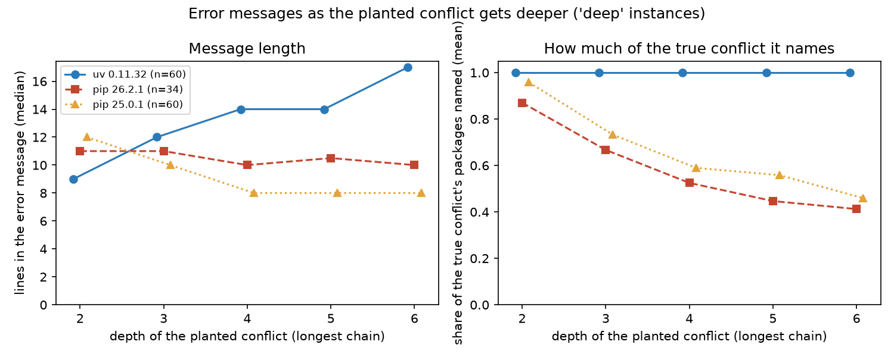
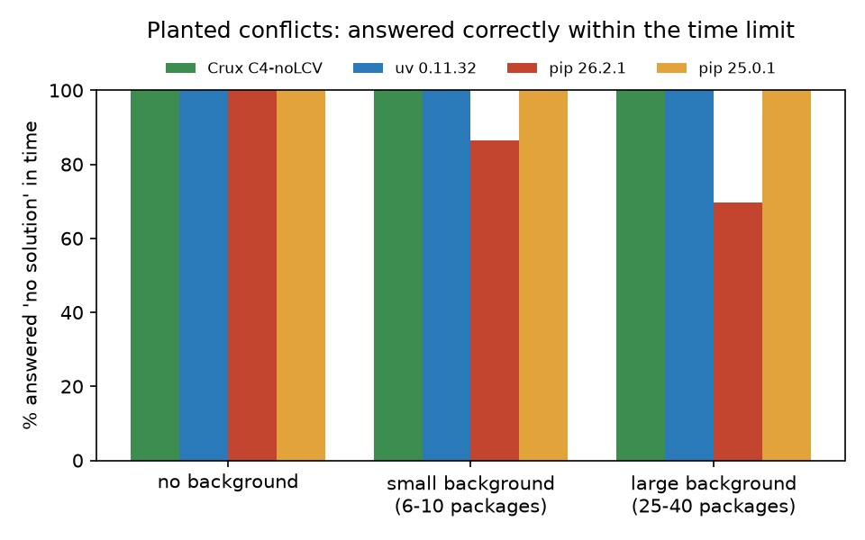
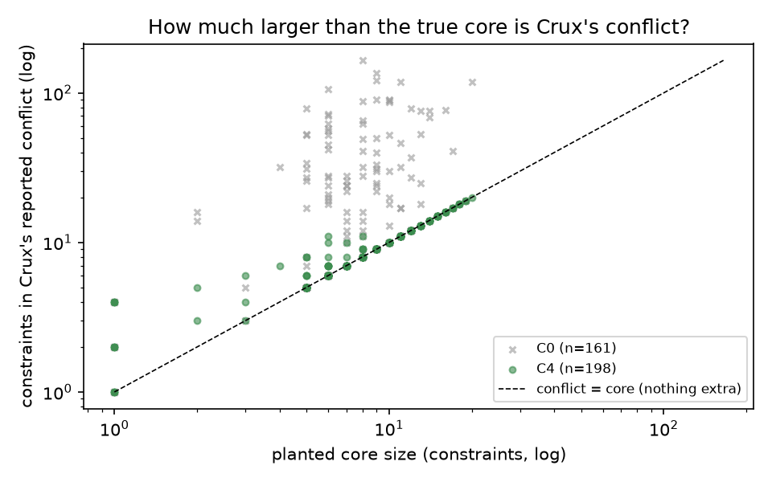
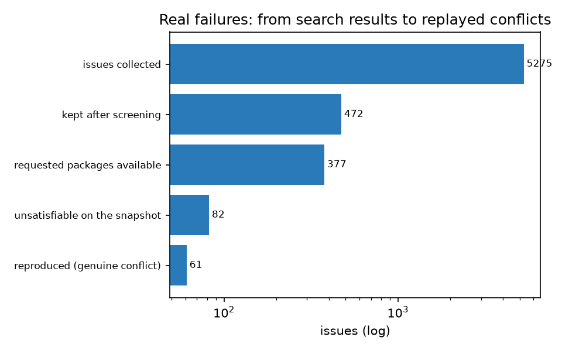

# Benchmark results

Generated by `python -m crux.benchmark.report` from the CSV files next to this report. Do not edit numbers by hand: re-run the script.

Tools: `pip 26.2.1` (main pip baseline) and `pip 25.0.1` (version check), both on Python 3.12.13; `uv 0.11.32`. Machine: Linux-6.18.44-fc-v470-x86_64-with-glibc2.39, 2 CPUs, Python 3.12.13 for Crux. Timeout 60 s; Crux configurations 10 s. Timings: median of 5 sequential runs per instance.

## Planted conflicts (198 instances, every one proven unsatisfiable with a unique minimal core)

### Outcome

| tool | no solution (correct) | timeout (60 s) | error | found a plan |
|---|---|---|---|---|
| Crux C4-noLCV | 198/198 (100%) | 0 | 0 | 0 |
| uv 0.11.32 | 198/198 (100%) | 0 | 0 | 0 |
| pip 26.2.1 | 169/198 (85%) | 29 | 0 | 0 |
| pip 25.0.1 | 198/198 (100%) | 0 | 0 | 0 |

Answered "no solution" within 60 s, by noise:

| noise | Crux C4-noLCV | uv 0.11.32 | pip 26.2.1 | pip 25.0.1 |
|---|---|---|---|---|
| none | 66/66 (100%) | 66/66 (100%) | 66/66 (100%) | 66/66 (100%) |
| small | 66/66 (100%) | 66/66 (100%) | 57/66 (86%) | 66/66 (100%) |
| large | 66/66 (100%) | 66/66 (100%) | 46/66 (70%) | 66/66 (100%) |

### Time (end to end, instances the tool finished)

| tool | instances finished | median s | p95 s | max s |
|---|---|---|---|---|
| Crux C4-noLCV | 198 | 0.08 | 0.11 | 0.15 |
| uv 0.11.32 | 198 | 0.08 | 0.09 | 0.10 |
| pip 26.2.1 | 169 | 0.34 | 1.78 | 21.98 |

### Messages (instances where the tool answered 'no solution')

| tool | n | message lines (median) | all output lines (median) | statements (median) | names a requested package | core packages named (mean recall) | named that are in the core (mean precision) | false 'no matching distributions' |
|---|---|---|---|---|---|---|---|---|
| uv 0.11.32 | 198 | 11.00 | 11.00 | 4.00 | 198/198 (100%) | 1.00 | 1.00 | – |
| pip 26.2.1 | 169 | 11.00 | 25.00 | 3.00 | 140/169 (83%) | 0.82 | 0.98 | 121/169 (72%) of messages (132 print the section) |
| pip 25.0.1 | 198 | 9.00 | 23.00 | 3.00 | 147/198 (74%) | 0.78 | 1.00 | 0/198 (0%) of messages (0 print the section) |

Message lines by conflict depth ('deep' instances):

| depth | uv 0.11.32 | pip 26.2.1 | pip 25.0.1 |
|---|---|---|---|
| 2 | 9 lines, names 1.00 of the core (n=12) | 11 lines, names 0.87 of the core (n=9) | 12 lines, names 0.96 of the core (n=12) |
| 3 | 12 lines, names 1.00 of the core (n=12) | 11 lines, names 0.67 of the core (n=9) | 10 lines, names 0.73 of the core (n=12) |
| 4 | 14 lines, names 1.00 of the core (n=12) | 10 lines, names 0.53 of the core (n=5) | 8 lines, names 0.59 of the core (n=12) |
| 5 | 14 lines, names 1.00 of the core (n=12) | 10 lines, names 0.45 of the core (n=6) | 8 lines, names 0.56 of the core (n=12) |
| 6 | 17 lines, names 1.00 of the core (n=12) | 10 lines, names 0.41 of the core (n=5) | 8 lines, names 0.46 of the core (n=12) |

### Crux configurations

| config | no solution | timeout | found a plan | nodes (median, finished) | conflict contains planted core | conflict IS the planted core | conflict size / core size (median) |
|---|---|---|---|---|---|---|---|
| C0 | 161/198 (81%) | 37 | 0 | 38.00 | 161/161 (100%) | 66/161 (41%) | 1.80 |
| C1 | 166/198 (84%) | 32 | 0 | 20.00 | 166/166 (100%) | 66/166 (40%) | 1.52 |
| C2 | 197/198 (99%) | 1 | 0 | 10.00 | 197/197 (100%) | 66/197 (34%) | 1.50 |
| C3 | 197/198 (99%) | 1 | 0 | 10.00 | 197/197 (100%) | 66/197 (34%) | 1.50 |
| C4 | 198/198 (100%) | 0 | 0 | 8.00 | 198/198 (100%) | 168/198 (85%) | 1.00 |
| C4-noLCV | 198/198 (100%) | 0 | 0 | 8.00 | 198/198 (100%) | 168/198 (85%) | 1.00 |

Timeouts by noise level:

| noise | C0 | C1 | C2 | C3 | C4 | C4-noLCV |
|---|---|---|---|---|---|---|
| none | 0/66 | 0/66 | 0/66 | 0/66 | 0/66 | 0/66 |
| small | 6/66 | 6/66 | 0/66 | 0/66 | 0/66 | 0/66 |
| large | 31/66 | 26/66 | 1/66 | 1/66 | 0/66 | 0/66 |

## Real failures

Issues collected: **5275** (pip's tracker 131, uv's tracker 582, other projects quoting pip's error 1965, other projects quoting uv's error 2597).

Screening (one reason per dropped issue):

| outcome | issues |
|---|---|
| kept: a usable request | 472 |
| dropped: no_request | 4322 |
| dropped: unsupported_flag | 105 |
| dropped: local_or_url | 75 |
| dropped: duplicate | 67 |
| dropped: constraint | 62 |
| dropped: requirements_file | 62 |
| dropped: unparseable | 46 |
| dropped: non_pypi_index | 32 |
| dropped: extras | 26 |
| dropped: local_version | 4 |
| dropped: marker | 1 |
| dropped: after_cutoff | 1 |

Kept requests by source: gh 356, uvgh 65, uv 29, pip 22; by extraction method: A 308, B 164 (B = the user's install command, A = pip's 'The user requested' lines).

Replay of the kept requests on the snapshot as of each report date:

| outcome | cases |
|---|---|
| not_reproduced | 295 |
| root_unavailable | 85 |
| reproduced | 61 |
| missing_dependency | 21 |
| not_on_pypi | 10 |

**Is the replay the user's failure?** For each reproduced case whose post includes pip's own conflict lines, does pip, run on our replayed data, name at least one package that pip named for the user? Yes for **32 of 33**. 28 reproduced cases have no conflict lines to compare (their request came from a command, or from uv); they are genuine conflicts on real metadata, but not shown to be the reporter's.

### Tools on the reproduced real conflicts

| tool | no solution | timeout (60 s) | error | found a plan |
|---|---|---|---|---|
| Crux C4-noLCV | 61/61 (100%) | 0 | 0 | 0 |
| uv 0.11.32 | 61/61 (100%) | 0 | 0 | 0 |
| pip 26.2.1 | 61/61 (100%) | 0 | 0 | 0 |
| pip 25.0.1 | 61/61 (100%) | 0 | 0 | 0 |

Time:

| tool | instances finished | median s | p95 s | max s |
|---|---|---|---|---|
| Crux C4-noLCV | 61 | 0.20 | 11.91 | 19.15 |
| uv 0.11.32 | 61 | 0.10 | 0.27 | 0.44 |
| pip 26.2.1 | 61 | 0.41 | 1.15 | 2.10 |

Messages:

| tool | n | message lines (median) | all output lines (median) | statements (median) | names a requested package | false 'no matching distributions' |
|---|---|---|---|---|---|---|
| uv 0.11.32 | 61 | 6.00 | 6.00 | 2.00 | 61/61 (100%) | – |
| pip 26.2.1 | 61 | 10.00 | 16.00 | 2.00 | 61/61 (100%) | 50/61 (82%) of messages (50 print the section) |
| pip 25.0.1 | 61 | 8.00 | 14.00 | 2.00 | 61/61 (100%) | 0/61 (0%) of messages (0 print the section) |

Crux configurations:

| config | no solution | timeout | found a plan | nodes (median, finished) | conflict contains planted core | conflict IS the planted core | conflict size / core size (median) |
|---|---|---|---|---|---|---|---|
| C0 | 55/61 (90%) | 6 | 0 | 2.00 | – | – | – |
| C1 | 56/61 (92%) | 5 | 0 | 0.00 | – | – | – |
| C2 | 56/61 (92%) | 5 | 0 | 0.00 | – | – | – |
| C3 | 56/61 (92%) | 5 | 0 | 0.00 | – | – | – |
| C4 | 56/61 (92%) | 5 | 0 | 0.00 | – | – | – |
| C4-noLCV | 56/61 (92%) | 5 | 0 | 0.00 | – | – | – |

On **5** instances C0 timed out after 125,864 to 971,446 nodes while C1 (AC-3) answered with 0 search nodes. Timeouts in C1 to C4: 25, of which **25 at 0 search nodes**, i.e. before search began (AC-3 and domain setup on the largest graphs), on 5 instances.

## Figures

